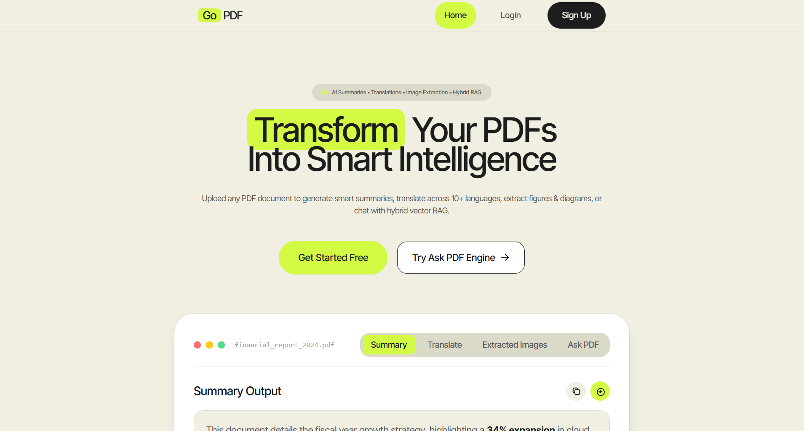
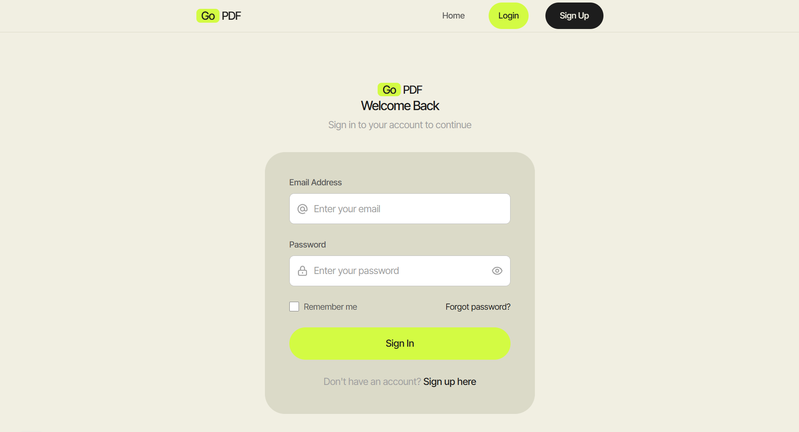
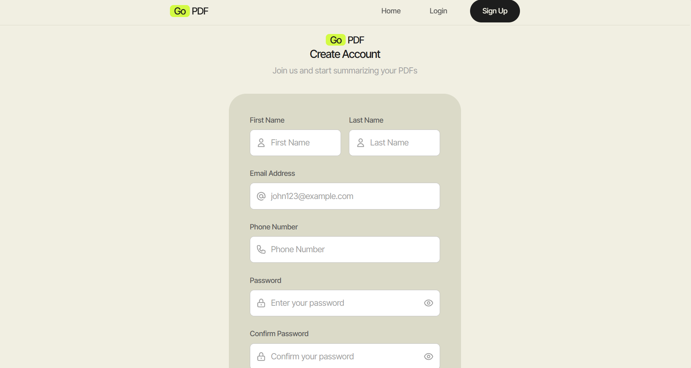
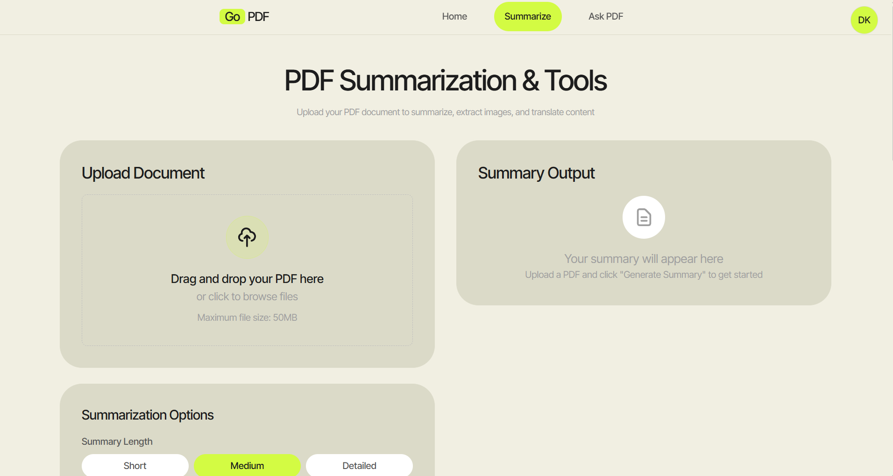
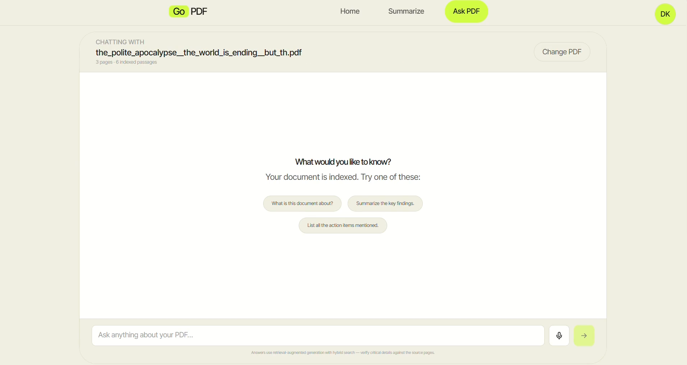

<p align="center">
  
</p>

> AI-powered PDF intelligence: structured summaries, translation, and source-cited chat with your documents.

GoPDF is a full-stack web application that turns long PDFs into something you can actually work with. Upload a document and get a structured, sectioned summary from a Cohere map-reduce pipeline, translate it into another language, or chat with it through a hybrid retrieval-augmented generation (RAG) stack that cites the exact pages it used.


---

## 📚 Table of Contents

- [Why GoPDF](#-why-gopdf)
- [Features](#-features)
- [Tech Stack](#-tech-stack)
- [Screenshots](#-screenshots)
- [Demo](#-demo)
- [Architecture](#-architecture)
- [Project Structure](#-project-structure)
- [Getting Started](#-getting-started)
  - [Prerequisites](#prerequisites)
  - [Installation](#installation)
  - [Environment Variables](#environment-variables)
  - [Running the Project](#running-the-project)
- [Author](#-author)
- [Acknowledgements](#-acknowledgements)

---

## 🎯 Why GoPDF

Reading a 60-page report to find three numbers is a bad use of an afternoon. GoPDF exists to make document analysis fast without sacrificing trust:

- **Grounded answers, not guesses.** Every chat answer is retrieved from the uploaded PDF and returned with page-level citations and snippets.
- **Summaries that keep the numbers.** The summarisation pipeline is tuned to preserve figures, percentages, and dates instead of generalising them away.
- **Privacy by default.** Ask PDF indexes documents in memory and never writes the file to disk. Summaries delete the temp upload immediately after processing.

**Typical use cases:** contract review, financial report analysis, academic literature triage, and technical documentation Q&A.

---

## ✨ Features

### Authentication

- 📝 Email/password signup with server-side validation and bcrypt hashing
- 🔐 JWT-based sessions with protected API middleware
- 🔁 Full password reset flow — SHA-256 hashed tokens, HTML email via Nodemailer
- 👤 Profile view/update and change-password endpoints

### PDF Summarisation

- 🧠 **Map-reduce summarisation** with Cohere — a small model extracts notes, a larger model synthesises them
- 📏 Three depth presets: **short**, **medium**, **detailed**
- 🎯 Two summary styles: **general** (prose) and **bullet** (bullet-point output)
- 🧾 Structured output: title, overview, per-section bullet points with page references, key takeaways, and extracted figures
- 🔢 Extractive safety net that restores verbatim figure-bearing sentences the model drops
- ⏱️ Rate-limit-aware throttling so long documents finish instead of dying on a 429
- 🗑️ Temp file cleanup guaranteed on success **and** failure

### Ask PDF (RAG)

- 📥 Drag-and-drop indexing for PDFs up to **50 MB**
- 🔍 **Hybrid retrieval**: dense vectors (Ollama `embeddinggemma-2:440m`) + BM25 sparse vectors, fused with Reciprocal Rank Fusion inside Qdrant
- 🎯 **Cross-encoder reranking** via Cohere (`rerank-v4.0-fast`), with graceful fallback to fusion order
- 🗣️ **Query condensation** so follow-ups like "and the second one?" still retrieve the right chunks
- 📌 Page-level source citations with snippets for every answer
- 💬 Conversation history (last 5 turns by default)
- 🧹 Document deletion endpoint that removes the indexed vectors
- 🩺 `/api/ask-pdf/health` readiness probe reporting which pipeline stages are wired up

---

## 🛠 Tech Stack

### Frontend (`client/`)

| Category        | Technology                                                                  |
| --------------- | --------------------------------------------------------------------------- |
| Framework       | React 19                                                                    |
| Build tool      | Vite 6                                                                      |
| Routing         | React Router DOM 7                                                          |
| Styling         | Tailwind CSS 3.4, PostCSS, Autoprefixer                                     |
| Animation       | Framer Motion                                                               |
| Markdown / Math | react-markdown, remark-gfm, remark-math, remark-breaks, rehype-katex, KaTeX |
| Icons           | lucide-react, react-icons                                                   |
| HTTP            | Native `fetch`, Axios                                                       |
| Notifications   | react-hot-toast                                                             |
| PDF generation  | pdf-lib                                                                     |
| Linting         | ESLint 9 (flat config)                                                      |

### Backend (`server/`)

| Category                    | Technology                                          |
| --------------------------- | --------------------------------------------------- |
| Runtime                     | Node.js (CommonJS)                                  |
| Framework                   | Express 5                                           |
| Database                    | MongoDB Atlas via Mongoose 8                        |
| Auth                        | jsonwebtoken, bcryptjs                              |
| File uploads                | Multer (memory storage for RAG, disk for summaries) |
| PDF parsing                 | pdf-parse, pdfjs-dist                               |
| LLM — summaries & reranking | Cohere (`cohere-ai`)                                |
| LLM — answers & translation | Google Gemini (`@google/genai`)                     |
| Embeddings                  | Ollama (`embeddinggemma-2:440m`, 768-dim)           |
| Vector DB                   | Qdrant (dense + BM25 sparse)                        |
| Email                       | Nodemailer (Gmail)                                  |
| Dev tooling                 | Nodemon, dotenv                                     |

---

## 📸 Screenshots

- **Home Page** 

- **Login Page** 

- **Signup Page** 

- **PDF Summary Page** 

- **Chat with PDF Page** 

---

## 🎬 Demo

---

## 🏗 Architecture

```
┌──────────────────────────────────────────────────────────────┐
│                    React 19 + Vite (client)                  │
│   Home · Login · Signup · Summarize · AskPDF · MathChat       │
│   Profile · ResetPassword        Tailwind · Framer Motion     │
└───────────────────────────┬──────────────────────────────────┘
                            │  fetch + Bearer JWT
┌───────────────────────────▼──────────────────────────────────┐
│                     Express 5 API (server)                    │
│  /api/auth  /api/summarize  /api/translate  /api/reasoning    │
│  /api/ask-pdf                                                 │
└───┬───────────────┬────────────────┬───────────────┬──────────┘
    │               │                │               │
┌───▼────┐   ┌──────▼──────┐  ┌──────▼──────┐  ┌─────▼──────┐
│MongoDB │   │   Cohere    │  │   Gemini    │  │   Ollama   │
│ users  │   │ map-reduce  │  │ answers +   │  │ embeddings │
│        │   │ + reranking │  │ translation │  │ (768-dim)  │
└────────┘   └─────────────┘  └─────────────┘  └─────┬──────┘
                                                     │
                                              ┌──────▼──────┐
                                              │   Qdrant    │
                                              │ dense+BM25  │
                                              └─────────────┘
```

### Ask PDF retrieval pipeline

1. **Extract** — `pdfjs-dist` pulls text per page from the uploaded buffer.
2. **Chunk** — pages are split into ~1,200-character chunks with 200-character overlap; headings and page numbers are preserved.
3. **Embed** — chunks are sent to Ollama in batches (default 8) against `embeddinggemma-2:440m`.
4. **Index** — Qdrant stores one dense vector plus a server-side `qdrant/bm25` sparse vector per chunk. The collection is created on first use with a `documentId` keyword index.
5. **Condense** — on each question, Gemini rewrites follow-ups into a standalone retrieval query using recent history.
6. **Retrieve** — hybrid search (dense + sparse) fused with RRF, filtered by `documentId`, returning up to 40 candidates.
7. **Rerank** — Cohere's cross-encoder trims candidates to the top 5 (configurable); if the key is missing the fusion order is used and reported.
8. **Generate** — Gemini answers strictly from the retrieved chunks with a system prompt that forbids outside knowledge.
9. **Cite** — the response includes page numbers, chunk indexes, snippets, and rerank scores.

### Summarisation pipeline

`pdf-parse` → heading/structure detection → paragraph-aware chunks (~4,000 chars) → **map** pass with `command-r7b-12-2024` (concurrency 3, plus an extractive figure safety net) → optional **mid reduce** → **final reduce** with `command-a-03-2025` → structured JSON (title, overview, sections, takeaways, figures). Section types like references and bibliographies are skipped or truncated before the map stage.

---

## 📁 Project Structure

```
.
├── client/                        # React + Vite frontend
│   ├── public/                    # Static assets (currently empty)
│   ├── src/
│   │   ├── Components/
│   │   │   ├── AskPDFComposer.jsx # Chat composer with voice input
│   │   │   ├── Footer.jsx
│   │   │   ├── FormatResponse.jsx # Markdown + KaTeX renderer
│   │   │   ├── Navbar.jsx
│   │   │   └── ScrollToTop.jsx
│   │   ├── Pages/
│   │   │   ├── Home.jsx           # Landing page with live preview
│   │   │   ├── Login.jsx
│   │   │   ├── Signup.jsx
│   │   │   ├── Summarization.jsx  # Upload, summarize, translate, download
│   │   │   ├── AskPDF.jsx         # RAG chat interface
│   │   │   ├── mathchat.jsx       # Math reasoning chat (lazy-loaded)
│   │   │   ├── Profile.jsx
│   │   │   └── ResetPassword.jsx
│   │   ├── App.jsx                # Routes + protected route guard
│   │   ├── main.jsx
│   │   ├── index.css              # Tailwind entry + design tokens
│   │   └── App.css
│   ├── index.html
│   ├── tailwind.config.js         # Palette, type scale, radii
│   ├── postcss.config.js
│   ├── vite.config.js
│   ├── eslint.config.js
│   └── package.json
│
├── server/                        # Express API
│   ├── lib/
│   │   ├── rag/
│   │   │   ├── config.js          # Env-driven pipeline settings + guards
│   │   │   ├── chunk.js           # Page extraction and chunking
│   │   │   ├── embed.js           # Ollama embedding client with retries
│   │   │   ├── qdrant.js          # Collection bootstrap, upsert, hybrid search
│   │   │   ├── rerank.js          # Cohere reranker with fallback
│   │   │   ├── llm.js             # Query condensation + grounded answers
│   │   │   └── prompt.js          # System prompt and context builder
│   │   └── pdfSummarizer.js       # Cohere map-reduce summariser
│   ├── middleware/
│   │   └── authMiddleware.js      # JWT verification + user lookup
│   ├── models/
│   │   └── User.js                # Mongoose user schema
│   ├── Routes/
│   │   ├── auth.js                # Signup, login, reset, profile
│   │   ├── summarize.js           # POST /api/summarize
│   │   ├── translation.js         # POST /api/translate
│   │   ├── reasoning.js           # POST /api/reasoning
│   │   └── askPdf.js              # Upload, ask, delete, health
│   ├── uploads/                   # Temp storage for summary uploads (cleaned up)
│   ├── index.js                   # App entry point
│   └── package.json
│
├── .gitignore
└── README.md
```

---

## 🚀 Getting Started

### Prerequisites

| Requirement               | Notes                                                                                                                                                            |
| ------------------------- | ---------------------------------------------------------------------------------------------------------------------------------------------------------------- |
| **Node.js 20+**           | The server uses the built-in `fetch` and `AbortSignal.timeout`.                                                                                                  |
| **npm**                   | Both `client/` and `server/` ship their own `package-lock.json`.                                                                                                 |
| **MongoDB**               | A local instance or a free MongoDB Atlas cluster.                                                                                                                |
| **Ollama**                | Required for Ask PDF embeddings. Pull the model: `ollama pull embeddinggemma-2:440m`.                                                                            |
| **Qdrant**                | Local (`docker run -p 6333:6333 qdrant/qdrant`) or Qdrant Cloud. Cloud is required for server-side BM25 inference unless you run the inference service yourself. |
| **Cohere API key**        | Powers summaries, reranking, and the reasoning endpoint.                                                                                                         |
| **Google Gemini API key** | Powers Ask PDF answers and translation.                                                                                                                          |
| **Gmail app password**    | Optional — only needed for password-reset emails.                                                                                                                |

### Installation

```bash
# 1. Clone
git clone https://github.com/harysri/Go-PDF.git
cd Go-PDF

# 2. Backend
cd server
npm install

# 3. Frontend
cd ../client
npm install
```

If you use Qdrant locally:

```bash
docker run -d --name qdrant -p 6333:6333 -p 6334:6334 \
  -v "$(pwd)/qdrant_storage:/qdrant/storage" qdrant/qdrant
```

If you use Ollama locally:

```bash
ollama serve
ollama pull embeddinggemma-2:440m
```

### Environment Variables

Create **`server/.env`** (it is git-ignored):

```env
# ── Core ──────────────────────────────────────────────
PORT=5000
MONGODB_URI=mongodb+srv://<user>:<password>@<cluster>/<db>
JWT_SECRET=replace-with-a-long-random-string
FRONTEND_URL=http://localhost:5173

# ── Email (password reset) ────────────────────────────
EMAIL_USER=you@gmail.com
EMAIL_PASS=your-16-character-app-password

# ── Cohere (summaries, reranking, reasoning) ──────────
COHERE_API_KEY=your-cohere-key
COHERE_RERANK_MODEL=rerank-v4.0-fast
COHERE_MAX_CALLS_PER_MINUTE=18

# ── Google Gemini (answers + translation) ─────────────
GEMINI_API_KEY=your-gemini-key
GEMINI_CHAT_MODEL=gemini-3.1-flash-lite
GEMINI_MAX_OUTPUT_TOKENS=2048

# ── Qdrant ────────────────────────────────────────────
QDRANT_URL=http://127.0.0.1:6333
QDRANT_API_KEY=
QDRANT_COLLECTION=askpdf_docs
QDRANT_TIMEOUT_MS=30000

# ── Ollama embeddings ─────────────────────────────────
OLLAMA_URL=http://127.0.0.1:11434
EMBEDDING_MODEL=embeddinggemma-2:440m
EMBEDDING_DIM=768
EMBEDDING_BATCH_SIZE=8
EMBEDDING_TIMEOUT_MS=120000

# ── RAG tuning (optional) ─────────────────────────────
RAG_TOP_N=5
RAG_TOP_K=10
RAG_CANDIDATE_K=40
RAG_CHUNK_SIZE=1200
RAG_CHUNK_OVERLAP=200
RAG_MIN_CHUNK_CHARS=40
RAG_MAX_CHUNKS=4000
RAG_HISTORY_MESSAGES=5
RAG_HISTORY_MESSAGE_CHARS=2000
```

### Running the Project

Open two terminals:

```bash
# Terminal 1 — API (nodemon, restarts on change)
cd server
npm run dev

# Terminal 2 — Frontend
cd client
npm run dev
```

| Service              | URL                                      |
| -------------------- | ---------------------------------------- |
| Frontend             | http://localhost:5173                    |
| API                  | http://localhost:5000                    |
| Qdrant dashboard     | http://localhost:6333/dashboard          |
| Ask PDF health check | http://localhost:5000/api/ask-pdf/health |

**Sanity check** — the health endpoint should report every stage as `ok`:

```bash
curl http://localhost:5000/api/ask-pdf/health
```

```json
{
  "ok": true,
  "embedder": {
    "ok": true,
    "url": "http://127.0.0.1:11434",
    "model": "embeddinggemma-2:440m"
  },
  "qdrant": { "ok": true, "collection": "askpdf_docs", "exists": true },
  "reranker": { "ok": true, "model": "rerank-v4.0-fast" },
  "chat": { "ok": true, "model": "gemini-3.1-flash-lite" }
}
```

If `ok` is `false`, the failing stage's message tells you what to fix (missing key, unreachable Ollama, missing collection).

---

## 💻 Usage

1. **Create an account** at `/Signup`, then sign in at `/login`.
2. **Summarise** — go to `/Summarize`, drop a PDF, pick a depth and style, and generate. Copy it, download it as a PDF, send it to the translation panel, or extract the PDF's embedded images separately.
3. **Ask your PDF** — go to `/AskPDF`, upload a document, wait for indexing, then ask questions. Each answer lists the pages and snippets it used. "Change PDF" deletes the old vectors.
4. **Math chat** — `/MathChat` sends prompts to the reasoning endpoint and renders LaTeX responses.
5. **Manage your account** — `/profile` for details and password changes.

---

---

## 👤 Author

**[Srihari Satheeshan]**

- GitHub: [@harysri](https://github.com/harysri)
- Email: [sriharisatheeshan820@gmail.com](mailto:sriharisatheeshan820@gmail.com)

---

## 🙏 Acknowledgements

- [React](https://react.dev/) and [Vite](https://vite.dev/) for the frontend toolchain
- [Tailwind CSS](https://tailwindcss.com/) and [Framer Motion](https://www.framer.com/motion/) for the UI
- [Express](https://expressjs.com/) and [Mongoose](https://mongoosejs.com/) for the API layer
- [Qdrant](https://qdrant.tech/) for hybrid dense + BM25 search
- [Ollama](https://ollama.com/) and the `embeddinggemma2` model for local embeddings
- [Cohere](https://cohere.com/) for summarisation and reranking
- [Google Gemini](https://ai.google.dev/) for grounded answers and translation
